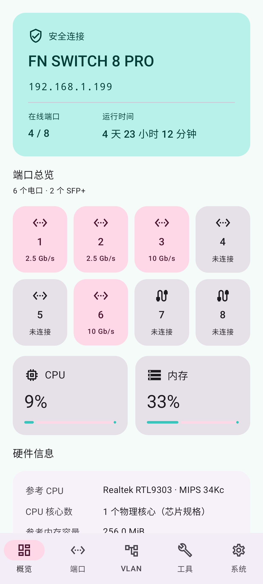
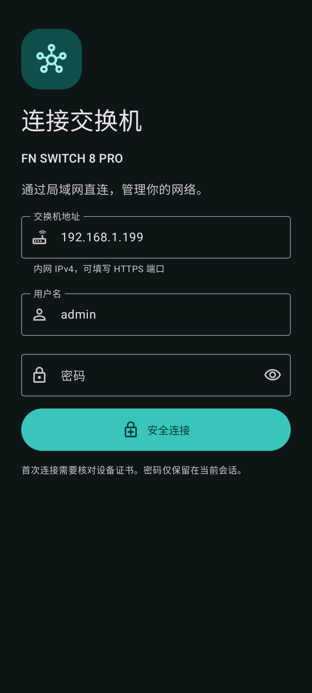

# FN SWITCH 8 PRO Manager

[简体中文](README.md) · [English](README.en.md) · [繁體中文](README.zh-TW.md) · [日本語](README.ja.md)

 

An independent Android LAN manager for **FN SWITCH 8 PRO / ST3208F**. Native Material 3 controls connect directly over HTTPS, without a NAS or cloud account.

[Download the latest APK](https://github.com/HachiMiku39/FN_SWITCH_8_PRO_MANAGER/releases/latest) · Android 8.0+

## Features

- Simplified Chinese, Traditional Chinese, English and Japanese; follow the system or choose a language.
- System/light/dark appearance; dynamic color, blue, green, purple, orange, and a **Hatsune Miku** palette using `#39C5BB` with pink accents and contrast-checked button text.
- Overview with firmware, time, uptime, CPU/RAM utilization and eight physical ports. Hardware fields are read when exposed by the device; clearly labeled model reference specifications fill otherwise unavailable fields.
- Native port state/description, Hybrid/Access/Trunk mode and PVID controls.
- Native VLAN creation, naming, deletion and tagged/untagged/excluded/forbidden membership. Hidden LAG rows are preserved and concurrent edits are checked.
- SNTP, startup configuration saving, configuration/firmware export, startup configuration restore and `.fmw` upload with SHA-256 and header/length/CRC checks.
- Searchable in-app web console for the device's advertised menus: **145 distinct pages** verified on the tested firmware, including routing, DHCP, ACL, STP, LAG, QoS, LLDP, multicast, SNMP, RMON and diagnostics.

The complete console retains the vendor's layout and device-provided languages. Not every page has been rewritten natively. It shares the current session through a certificate-pinned native HTTPS gateway restricted to the connected switch; WebView SSL errors are not bypassed.

## Use

1. Connect your phone to a LAN that can reach the switch. Enter its private IPv4 address, optional HTTPS port and existing administrator credentials.
2. Verify the certificate's SHA-256 fingerprint on first connection. Changed or expired certificates block access.
3. Choose appearance/language using the palette icon or System settings.
4. Save startup configuration after changes that must survive a reboot.
5. Select export/import files with the system picker. Restore and upgrade require explicit confirmation; submissions are not automatically replayed and the device is not automatically rebooted.

CRC detects corruption, not authenticity or exact model compatibility. Use ST3208F vendor firmware, make backups and maintain power. Configuration exports may contain credentials.

## Hardware and cooling

The reference teardown profile is RTL9303 / MIPS 34Kc, rated up to 800 MHz, with one ESMT M15T2G16128A providing 256 MiB DDR3(L). These are sample/specification values, not live clock or capacity measurements, and hardware revisions may differ. Device API fields take precedence.

[Realtek specifications](https://www.realtek.com/Product/Index?id=3719) · [ESMT specifications](https://www.esmt.com.tw/upload/pdf/ESMT/datasheets/M15T2G16128A%282P%29.pdf)

Static firmware analysis found `show fan` and read-only `/proc/fan`, exposing `temperature_c` and `pwm_level`. PWM is not RPM. No web manual-speed endpoint was found; no unverified fan-speed controls are presented. [Multilingual cooling notes](docs/FAN_STATUS.md)

## Build and test

Use JDK 17+, Android SDK Platform 35 and Build Tools 35.0.0. Set `ANDROID_HOME` or a local `local.properties`.

```sh
./gradlew :app:testDebugUnitTest :app:assembleRelease :app:lintRelease
node -e "import('./tools/console-bridge-test.mjs').then(async m=>console.log(await m.run()))"
```

Release builds are unsigned until signed with your own key. Published APK signing keys are not included in the repository.

Tests cover localized UI, themes, startup, certificate pinning, cookies/CSRF, VLAN preservation/concurrency, uploads and session cleanup. Optional live integration tests require `FN_SWITCH_TEST_HOST`, `FN_SWITCH_TEST_USER`, `FN_SWITCH_TEST_PASSWORD`, and `FN_SWITCH_TEST_PIN`; `FN_SWITCH_TEST_DEEP=1` reads all menu pages and exports configuration. Never commit these values.

Validated against V1.1.8-20261027-021: actual status reads, 145 page HTTP responses and running-configuration export. Restore/flashing use mocked device tests. Complex web dialogs and file pickers still need further physical Android validation; complete "101%" compatibility is not claimed.

## Privacy and notices

Private IPv4 only. Passwords and cookies stay in session memory; address, username, certificate pin and appearance/language preferences are stored locally. No ads, analytics, cloud backend or persistent service. Normal disconnect releases its own management session.

No real credentials, configuration backups, vendor firmware or decompiled binaries are included. Third-party notices: [NOTICE](app/src/main/assets/NOTICE.txt). This is not an official vendor application.
