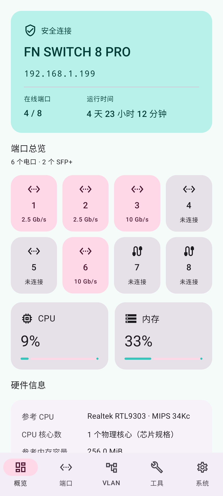
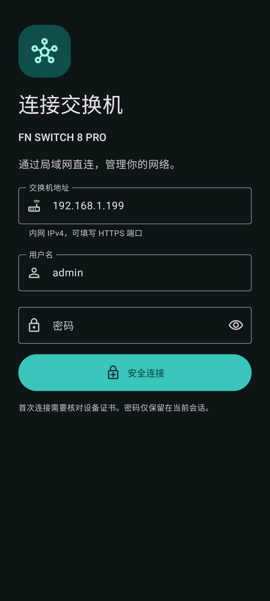

# FN SWITCH 8 PRO Manager

[简体中文](README.md) · [English](README.en.md) · [繁體中文](README.zh-TW.md) · [日本語](README.ja.md)

 

**FN SWITCH 8 PRO / ST3208F** 向けの非公式 Android LAN 管理アプリです。Material 3 のネイティブ画面から HTTPS で直接接続でき、NAS やクラウドアカウントは不要です。

[最新版 APK をダウンロード](https://github.com/HachiMiku39/FN_SWITCH_8_PRO_MANAGER/releases/latest) · Android 8.0 以降

## 機能

- 簡体字中国語、繁体字中国語、英語、日本語。システムに従う設定と手動切り替え。
- システム／ライト／ダークテーマ、ダイナミックカラーと青・緑・紫・オレンジ。**初音ミク**カラーは `#39C5BB` を主体にピンクを組み合わせ、ボタン文字のコントラストを確認しています。
- 概要画面にファームウェア、時刻、稼働時間、CPU／メモリ使用率、8 個の物理ポートを表示。API のハードウェア情報を優先し、参考仕様は区別して表示。
- ポートの有効／無効、説明、Hybrid／Access／Trunk、PVID。
- VLAN の作成・名前変更・削除、タグ付き／タグなし／除外／参加禁止の編集。非表示の LAG 行を保持し、同時変更を検出。
- SNTP、起動設定保存、設定／ファームウェアのエクスポート、起動設定復元、`.fmw` アップロード。SHA-256、ヘッダー、サイズ、CRC を確認。
- 検索可能なアプリ内完全版 Web コンソール。検証したファームウェアでは **145 ページ**を提供し、ルーティング、DHCP、ACL、STP、LAG、QoS、LLDP、マルチキャスト、SNMP、RMON、診断にアクセス可能。

完全版コンソールはメーカーのレイアウトとデバイスの言語を使用します。全画面をネイティブに書き直したものではありません。接続中のスイッチだけに制限された証明書固定の HTTPS 経路でセッションを共有し、WebView の SSL エラーは無視しません。

## 使用方法

1. スイッチに到達できる LAN に接続し、プライベート IPv4、任意の HTTPS ポート、既存の管理者認証情報を入力します。
2. 初回は証明書の SHA-256 指紋を照合します。変更・期限切れの証明書では接続しません。
3. パレットアイコンまたはシステム画面で外観と言語を選びます。
4. 再起動後も保持したい変更は起動設定に保存します。
5. システムのファイル選択画面で入出力します。復元・更新は確認が必要で、自動再送や自動再起動は行いません。

CRC は破損検出用で、真正性や機種の互換性を保証しません。ST3208F 用のメーカー製ファームウェアを使用し、事前にバックアップして電源を維持してください。設定ファイルには認証情報が含まれる場合があります。

## ハードウェアと冷却

分解サンプルの参考仕様は RTL9303／MIPS 34Kc、最大 800 MHz、ESMT M15T2G16128A × 1、256 MiB DDR3(L) です。実測のクロックや容量ではなく、改版により異なる可能性があります。API が提供する値を優先します。

[Realtek 仕様](https://www.realtek.com/Product/Index?id=3719) · [ESMT 仕様](https://www.esmt.com.tw/upload/pdf/ESMT/datasheets/M15T2G16128A%282P%29.pdf)

静的解析で `show fan` と読み取り専用 `/proc/fan` を確認しました。`temperature_c` と `pwm_level` を出力しますが、PWM は RPM ではありません。Web の手動速度設定 API は見つかっていません。[冷却に関する多言語メモ](docs/FAN_STATUS.md)

## ビルドと検証

JDK 17+、Android SDK Platform 35、Build Tools 35.0.0 が必要です。`ANDROID_HOME` またはローカルの `local.properties` を設定してください。

```sh
./gradlew :app:testDebugUnitTest :app:assembleRelease :app:lintRelease
node -e "import('./tools/console-bridge-test.mjs').then(async m=>console.log(await m.run()))"
```

Release は未署名で生成されます。自分の鍵で署名してください。公開 APK の秘密鍵は含まれていません。

言語、テーマ、起動、証明書、Cookie／CSRF、VLAN 保持・同時編集、アップロード、セッション終了をテストします。任意の実機テストは `FN_SWITCH_TEST_HOST`、`FN_SWITCH_TEST_USER`、`FN_SWITCH_TEST_PASSWORD`、`FN_SWITCH_TEST_PIN` で有効化し、`FN_SWITCH_TEST_DEEP=1` ではメニューと設定エクスポートも確認します。これらの値をコミットしないでください。

V1.1.8-20261027-021 で状態読み取り、145 ページの HTTP 応答、実行中設定のエクスポートを確認しました。復元・書き込み更新は模擬デバイスで検証しています。複雑な Web ダイアログやファイル選択は実際の Android で追加検証が必要で、「101%」の互換性を保証しません。

## プライバシーと注記

プライベート IPv4 のみ対応。パスワードと Cookie はセッションのメモリ内だけに保持し、アドレス、ユーザー名、証明書の指紋、外観と言語の設定は端末に保存します。広告、解析 SDK、クラウドサーバー、常駐サービスはありません。通常の切断時は自分の管理セッションを終了します。

実際の認証情報、設定バックアップ、メーカーファームウェア、逆アセンブルしたバイナリは含まれていません。第三者ライセンスは [NOTICE](app/src/main/assets/NOTICE.txt) を参照してください。メーカー公式アプリではありません。
