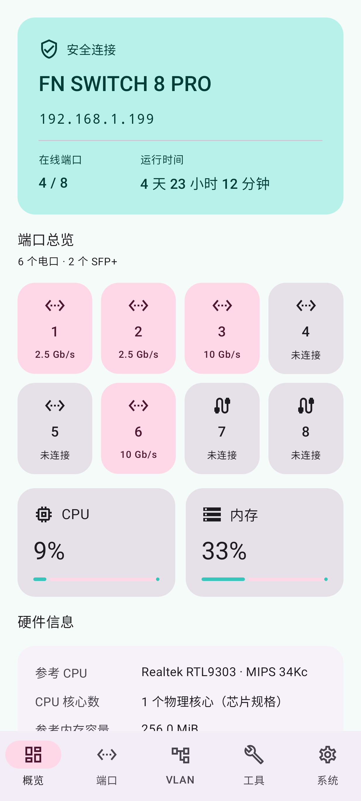
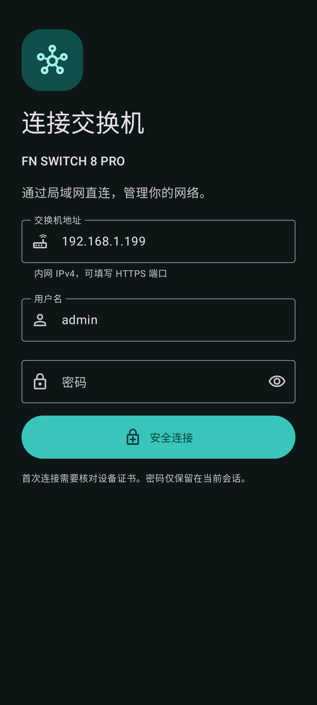

# FN SWITCH 8 PRO Manager

[简体中文](README.md) · [English](README.en.md) · [繁體中文](README.zh-TW.md) · [日本語](README.ja.md)

 

适用于 **FN SWITCH 8 PRO / ST3208F** 的第三方 Android 局域网管理应用。原生 Material 3 界面，通过 HTTPS 直连交换机，无需飞牛 NAS 或云账号。

[下载最新版 APK](https://github.com/HachiMiku39/FN_SWITCH_8_PRO_MANAGER/releases/latest) · Android 8.0+

## 功能

- 简体中文、繁体中文、英语、日语，支持跟随系统及手动切换。
- 跟随系统、浅色、深色主题；动态配色，以及 Google 蓝、森林绿、柔和紫、暖橙和**初音未来**配色。初音未来主题以 `#39C5BB` 为主色，搭配粉红色，按钮文字经过对比度检查。
- 概览：型号、固件、时间、运行时长、CPU/内存使用率、8 个物理端口状态及速率。设备接口提供硬件字段时读取并展示；缺少字段时可显示明确标记的型号参考规格。
- 原生端口启停、备注，Hybrid/Access/Trunk 模式及 PVID。
- 原生 VLAN 创建、命名、删除及 Tagged/Untagged/Excluded/Forbidden 成员编辑；保留未显示的 LAG 行并检查并发改动。
- SNTP、保存启动配置、导出配置/固件、恢复启动配置及 `.fmw` 固件上传。固件显示 SHA-256 并验证头部、长度和 CRC。
- 可搜索的完整网页控制台，在 App 内使用设备实际公布的全部菜单。本次验证为 **145 个不同页面**，涵盖路由、DHCP、ACL、STP、LAG、QoS、LLDP、组播、SNMP、RMON 与诊断等。

完整控制台保留厂家页面布局及设备提供的语言；并非所有页面都已原生重写。它与原生界面共享当前会话，所有请求经过限制为当前设备的固定证书 HTTPS 通道，不通过忽略 WebView 证书错误来连接。

## 使用

1. 手机接入能访问交换机的局域网，填写管理 IPv4、可选 HTTPS 端口及现有管理员凭据。
2. 首次连接核对设备证书 SHA-256 指纹。证书变化或过期会阻止连接。
3. 在顶栏调色盘或“系统 → 外观与语言”选择语言、主题和配色。
4. 更改运行配置后，使用“保存配置”将其保留到重启后。
5. 备份通过系统文件选择器保存；恢复或升级需明确确认，不自动重试提交或重启设备。

CRC 用于发现文件损坏，不证明来源可信或型号匹配。请使用适用于 ST3208F 的厂商固件，先做好备份并保持供电。配置备份可能包含凭据，请选择私人存放位置。

## 硬件与温控

型号参考配置为 RTL9303 / MIPS 34Kc、最高 800 MHz，以及单颗 ESMT M15T2G16128A 的 256 MiB DDR3(L)。这些是拆机样本及原厂资料，不代表所有硬件修订，也不是实时频率/容量探测。设备 API 提供数据时优先采用其读数。

[CPU 原厂资料](https://www.realtek.com/Product/Index?id=3719) · [内存原厂资料](https://www.esmt.com.tw/upload/pdf/ESMT/datasheets/M15T2G16128A%282P%29.pdf)

风扇静态分析找到 CLI `show fan` 和只读 `/proc/fan`，包含 `temperature_c`、`pwm_level`；后者不是 RPM。当前未找到网页手动调速接口，App 不提供未经验证的手动调速按钮。[四语言温控分析说明](docs/FAN_STATUS.md)

## 构建和验证

需要 JDK 17+、Android SDK Platform 35、Build Tools 35.0.0。使用 `ANDROID_HOME` 或本机 `local.properties` 指定 SDK。

```sh
./gradlew :app:testDebugUnitTest :app:assembleRelease :app:lintRelease
```

`assembleRelease` 生成未签名包。正式下载包使用独立发布密钥签名，私钥不在仓库中。

```sh
node -e "import('./tools/console-bridge-test.mjs').then(async m=>console.log(await m.run()))"
```

测试包括四语言界面、主题、启动、固定证书、Cookie/CSRF、VLAN 保留与并发检查、上传和会话释放。实机集成测试默认跳过；通过 `FN_SWITCH_TEST_HOST`、`FN_SWITCH_TEST_USER`、`FN_SWITCH_TEST_PASSWORD`、`FN_SWITCH_TEST_PIN` 启用，`FN_SWITCH_TEST_DEEP=1` 还会读取菜单页面并导出配置。不要把这些环境变量写入仓库。

验证基准为 V1.1.8-20261027-021。已验证真实设备状态读取、145 个页面 HTTP 访问和运行配置导出；配置恢复及刷机采用模拟接口验证。复杂网页弹窗与文件选择仍需实体 Android 进一步验证，不宣称“101%”兼容。

## 隐私及第三方组件

仅接受内网 IPv4。密码和 Cookie 只在会话内存中保存；本地保留地址、用户名、证书指纹和外观/语言偏好。无广告、统计 SDK、云后端或常驻服务。普通退出连接会释放自己的管理会话。

仓库不包含真实设备凭据、配置备份、厂商固件或反编译二进制。第三方组件许可见 [NOTICE](app/src/main/assets/NOTICE.txt)。本项目非厂商官方应用。
