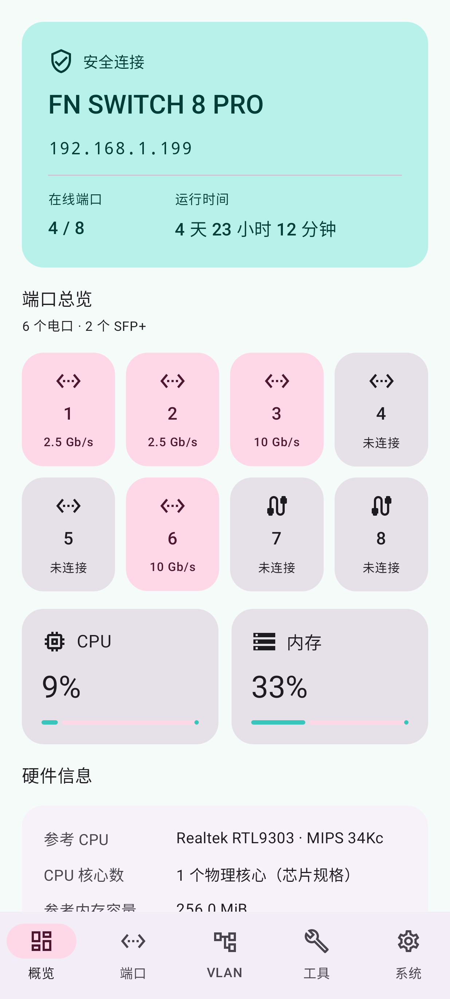
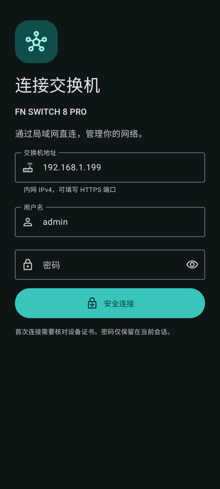

# FN SWITCH 8 PRO Manager

[简体中文](README.md) · [English](README.en.md) · [繁體中文](README.zh-TW.md) · [日本語](README.ja.md)

 

適用 **FN SWITCH 8 PRO / ST3208F** 的第三方 Android 區域網路管理應用程式。原生 Material 3 介面，以 HTTPS 直連交換機，無需 NAS 或雲端帳號。

[下載最新版 APK](https://github.com/HachiMiku39/FN_SWITCH_8_PRO_MANAGER/releases/latest) · Android 8.0+

## 功能

- 簡體中文、繁體中文、英語、日語，可跟隨系統或手動選擇。
- 系統／淺色／深色主題、動態配色與藍、綠、紫、橙色；**初音未來**主題以 `#39C5BB` 搭配粉紅色，按鈕文字已檢查對比度。
- 概覽顯示韌體、時間、執行時間、CPU／記憶體使用率與 8 個實體連接埠。裝置提供的硬體欄位優先；參考規格會明確標記。
- 原生連接埠啟停、備註、Hybrid／Access／Trunk 與 PVID。
- 原生 VLAN 建立、命名、刪除及標記／未標記／排除／禁止成員編輯，保留隱藏 LAG 設定並檢查並行變更。
- SNTP、啟動設定儲存、設定／韌體匯出、啟動設定還原與 `.fmw` 上傳，含 SHA-256、標頭、長度及 CRC 檢查。
- App 內可搜尋的完整網頁控制台。測試韌體公布 **145 個不同頁面**，包含路由、DHCP、ACL、STP、LAG、QoS、LLDP、群播、SNMP、RMON 與診斷。

完整控制台保留廠商版面與裝置提供的語言，並非所有功能都已原生重寫。控制台共用目前工作階段，透過限制為目前交換機的固定憑證 HTTPS 通道連接，不略過 WebView SSL 錯誤。

## 使用

1. 手機連入可存取交換機的網路，輸入內網 IPv4、選用的 HTTPS 連接埠及現有管理員憑據。
2. 首次連接核對憑證 SHA-256 指紋。憑證變更或到期會阻止連線。
3. 在調色盤圖示或系統頁選擇外觀與語言。
4. 需要重新啟動後保留的變更，請儲存啟動設定。
5. 透過系統檔案選擇器匯入／匯出。還原與升級需明確確認，不自動重送或重新啟動。

CRC 僅偵測損壞，不保證來源可信或型號相容。請使用 ST3208F 廠商韌體，先備份並維持供電。設定備份可能含有憑據。

## 硬體及溫控

參考拆機配置：RTL9303／MIPS 34Kc、最高 800 MHz，單顆 ESMT M15T2G16128A，256 MiB DDR3(L)。這是樣本與規格資料，並非即時頻率或容量測量；硬體版本可能不同。裝置 API 資料優先。

[Realtek 資料](https://www.realtek.com/Product/Index?id=3719) · [ESMT 資料](https://www.esmt.com.tw/upload/pdf/ESMT/datasheets/M15T2G16128A%282P%29.pdf)

已從韌體找到 `show fan` 及唯讀 `/proc/fan`，欄位為 `temperature_c`、`pwm_level`；PWM 並非 RPM。尚未找到網頁手動調速介面。[多語溫控分析](docs/FAN_STATUS.md)

## 建置與驗證

需要 JDK 17+、Android SDK Platform 35、Build Tools 35.0.0。使用 `ANDROID_HOME` 或本機 `local.properties` 指定 SDK。

```sh
./gradlew :app:testDebugUnitTest :app:assembleRelease :app:lintRelease
node -e "import('./tools/console-bridge-test.mjs').then(async m=>console.log(await m.run()))"
```

Release 預設為未簽名套件，請使用自己的金鑰簽署。公開下載套件的簽署私鑰不在倉庫內。

涵蓋語言、主題、啟動、憑證、Cookie／CSRF、VLAN 保留與並行檢查、上傳及工作階段釋放。選用實機測試使用 `FN_SWITCH_TEST_HOST`、`FN_SWITCH_TEST_USER`、`FN_SWITCH_TEST_PASSWORD`、`FN_SWITCH_TEST_PIN`；`FN_SWITCH_TEST_DEEP=1` 會讀取全部選單頁面並匯出設定，請勿提交這些值。

以 V1.1.8-20261027-021 驗證讀取、145 個頁面 HTTP 回應與執行設定匯出；還原／刷機採模擬驗證。複雜網頁彈窗與檔案選擇仍需實體 Android 進一步測試，不宣稱「101%」相容。

## 隱私與聲明

僅接受內網 IPv4。密碼與 Cookie 只保留於工作階段記憶體，本機保存位址、使用者名稱、憑證指紋與外觀／語言偏好。無廣告、統計、雲端後端或常駐服務。一般中斷連線會釋放自己的管理工作階段。

不包含真實憑據、設定備份、廠商韌體或反編譯二進位檔。第三方元件授權見 [NOTICE](app/src/main/assets/NOTICE.txt)。非廠商官方應用程式。
